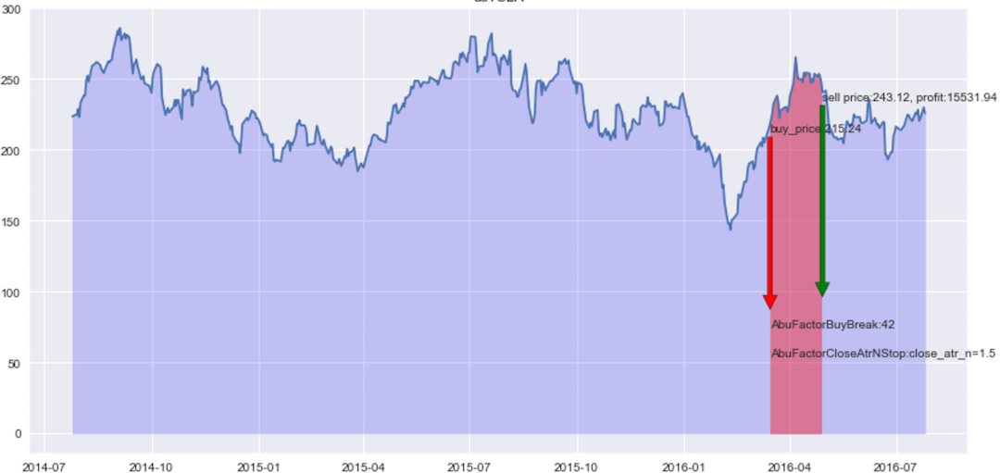
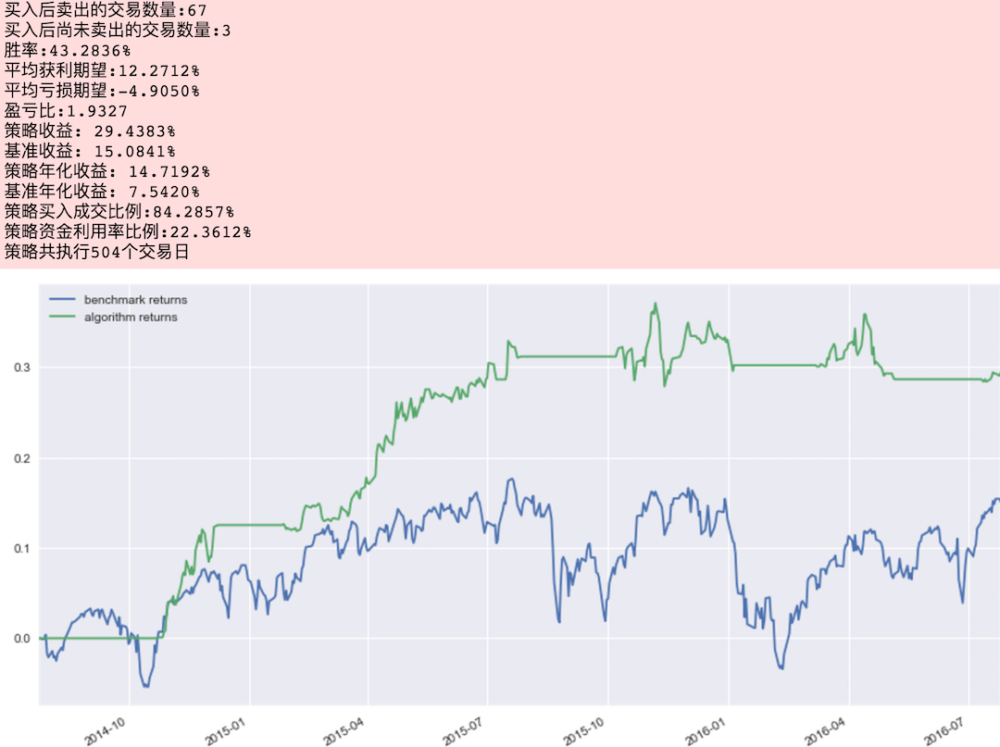

### 索引

| 内容 | 位置 | 
| ------| ------ | 
| 阿布量化系统源代码 | abupy目录 |
| 阿布量化使用教程 | abupy_lecture目录 |
| 阿布量化非编程界面操作 | abupy_ui目录 |
| 《量化交易之路》示例代码 | ipython／python目录| 
| 《机器学习之路》示例代码 | https://github.com/maxmon/abu_ml | 


###  🏆 [览器访问网址: https://www.abuquant.com](https://www.abuquant.com)

1. [上证指数(000001) 实时AI研报:](https://www.abuquant.com/abu_context/output_gi_week3/report/000001/index.html)
2. [黄金/美元(XAU) 实时AI研报](https://www.abuquant.com/abu_context/output_gi_week3/report/XAU/index.html)
3. [纳斯达克(NDX) 实时AI研报](https://www.abuquant.com/abu_context/output_gi_week3/report/NDX/index.html)
4. [恒生指数(HSI) 实时AI研报](https://www.abuquant.com/abu_context/output_gi_week3/report/HSI/index.html)
5. [深证成指(399001) 实时AI研报](https://www.abuquant.com/abu_context/output_gi_week3/report/399001/index.html)
6. [美元兑离岸人民币(USDCNH) 实时AI研报](https://www.abuquant.com/abu_context/output_gi_week3/report/USDCNH/index.html)
7. [白银ETF(SLV) 实时AI研报](https://www.abuquant.com/abu_context/output_gi_week3/report/SLV/index.html)
8. [日経225(N225) 实时AI研报](https://www.abuquant.com/abu_context/output_gi_week3/report/N225/index.html)
9. [标普500(SPX) 实时AI研报](https://www.abuquant.com/abu_context/output_gi_week3/report/SPX/index.html)
10. [创业板指(399006) 实时AI研报](https://www.abuquant.com/abu_context/output_gi_week3/report/399006/index.html)
11. [沪深300(000300) 实时AI研报](https://www.abuquant.com/abu_context/output_gi_week3/report/000300/index.html)
12. [NYMEX原油(CL00Y) 实时AI研报](https://www.abuquant.com/abu_context/output_gi_week3/report/CL00Y/index.html)
13. [苹果(AAPL) 实时AI研报](https://www.abuquant.com/abu_context/output_gi_week3/report/AAPL/index.html)
14. [COMEX黄金(GC00Y) 实时AI研报](https://www.abuquant.com/abu_context/output_gi_week3/report/GC00Y/index.html)
15. [美元兑日元(USDJPY) 实时AI研报](https://www.abuquant.com/abu_context/output_gi_week3/report/USDJPY/index.html)
16. [韩国KOSPI(KOSPI) 实时AI研报](https://www.abuquant.com/abu_context/output_gi_week3/report/KOSPI/index.html)
17. [腾讯控股(00700) 实时AI研报](https://www.abuquant.com/abu_context/output_gi_week3/report/00700/index.html)
18. [上证50(000016) 实时AI研报](https://www.abuquant.com/abu_context/output_gi_week3/report/000016/index.html)
19. [科创50(000688) 实时AI研报](https://www.abuquant.com/abu_context/output_gi_week3/report/000688/index.html)
20. [英国富时100(FTSE) 实时AI研报](https://www.abuquant.com/abu_context/output_gi_week3/report/FTSE/index.html)
21. [红筹指数(HSCCI) 实时AI研报](https://www.abuquant.com/abu_context/output_gi_week3/report/HSCCI/index.html)
22. [道琼斯(DJIA) 实时AI研报](https://www.abuquant.com/abu_context/output_gi_week3/report/DJIA/index.html)
23. [法国CAC40(FCHI) 实时AI研报](https://www.abuquant.com/abu_context/output_gi_week3/report/FCHI/index.html)
24. [德国DAX30(GDAXI) 实时AI研报](https://www.abuquant.com/abu_context/output_gi_week3/report/GDAXI/index.html)
25. 🇨🇳 [沪深市场量化示例分析列表](https://www.abuquant.com/cn3/cn_symbol_list.html)
26. 🇺🇸 [美股市场量化示例分析列表](https://www.abuquant.com/us3/us_symbol_list.html)
27. 🚩 [港股市场量化示例分析列表](https://www.abuquant.com/hk3/hk_symbol_list.html)
28. 📡 [图形信号 交织 图形信号 策略:](https://www.abuquant.com/find_itl_v3.html)

	* 📐[上升三角整理向上突破＋缠论｜谐波｜趋势线｜波浪｜形态模型:](https://www.abuquant.com/itl_feature3/pattern_90triangle_up_up_break_symbol_list.html)
	* 🌊[波浪理论回调浪c点＋缠论｜谐波｜趋势线｜波浪｜形态模型:](https://www.abuquant.com/itl_feature3/dn_5wr_c_revert_symbol_list.html)
	* ✂️[升趋势向下破位风险＋缠论｜谐波｜趋势线｜波浪｜形态模型:](https://www.abuquant.com/itl_feature3/trend_breakthrough_risk_symbol_list.html)
	* 🐶[c点将上涨到d点完成降赛福＋缠论｜谐波｜趋势线｜波浪｜形态模型:](https://www.abuquant.com/itl_feature3/dn_cypher_xabc_predict_symbol_list.html)
	* ☯[缠论中继❸买向上＋缠论｜谐波｜趋势线｜波浪｜形态模型:](https://www.abuquant.com/itl_feature3/dn_right_tangle_three_symbol_list.html)
	* 🚩[降楔型整理向上突破＋缠论｜谐波｜趋势线｜波浪｜形态模型:](https://www.abuquant.com/itl_feature3/pattern_wedge_dn_break_symbol_list.html)
	* 🦇[蝙蝠到达升蝙蝠d点＋缠论｜谐波｜趋势线｜波浪｜形态模型:](https://www.abuquant.com/itl_feature3/up_bat_abcd_regular_symbol_list.html)
	* ☯️[缠论中继❷买向上＋缠论｜谐波｜趋势线｜波浪｜形态模型:](https://www.abuquant.com/itl_feature3/dn_right_tangle_two_symbol_list.html)
	* 🌊[波浪理论回调浪反转＋缠论｜谐波｜趋势线｜波浪｜形态模型:](https://www.abuquant.com/itl_feature3/up_5wr_c_revert_symbol_list.html)
	* ⚔️[趋势线突破机会＋缠论｜谐波｜趋势线｜波浪｜形态模型:](https://www.abuquant.com/itl_feature3/trend_breakthrough_chance_symbol_list.html)
	* ☯️[缠论中继❸卖向下＋缠论｜谐波｜趋势线｜波浪｜形态模型:](https://www.abuquant.com/itl_feature3/up_right_tangle_three_symbol_list.html)
	* 🐶[降赛福d点完成＋缠论｜谐波｜趋势线｜波浪｜形态模型:](https://www.abuquant.com/itl_feature3/dn_cypher_xabc_predict_symbol_list.html)
	* ▴▲▴[头肩顶向下突破＋缠论｜谐波｜趋势线｜波浪｜形态模型:](https://www.abuquant.com/itl_feature3/trend_support_encounter_dn_symbol_list.html)
	* ✂️[升趋势强支撑破位可能＋缠论｜谐波｜趋势线｜波浪｜形态模型:](https://www.abuquant.com/itl_feature3/pattern_head_top_break_symbol_list.html)
	* 🌊[上涨回调浪中继b＋缠论｜谐波｜趋势线｜波浪｜形态模型:](https://www.abuquant.com/itl_feature3/dn_5wr_b_pos_symbol_list.html)
	* 🦊[降伽利d点完成＋缠论｜谐波｜趋势线｜波浪｜形态模型:](https://www.abuquant.com/itl_feature3/dn_gartley_abcd_predict_symbol_list.html)
	* ☯️[缠论中继❷卖向下＋缠论｜谐波｜趋势线｜波浪｜形态模型:](https://www.abuquant.com/itl_feature3/up_right_tangle_two_symbol_list.html)
	* ✂️[升趋势强支撑破位可能＋缠论｜谐波｜趋势线｜波浪｜形态模型:](https://www.abuquant.com/itl_feature3/pattern_head_top_break_symbol_list.html)
	* ❐[下跌矩形达成下跌目标＋缠论｜谐波｜趋势线｜波浪｜形态模型:](https://www.abuquant.com/itl_feature3/pattern_rect_dn_up_target_symbol_list.html)
	* 🌊[波浪理论下跌中继c＋缠论｜谐波｜趋势线｜波浪｜形态模型:](https://www.abuquant.com/itl_feature3/up_5wr_c_regular_symbol_list.html)
	* 🦀️[升螃蟹d点完成＋缠论｜谐波｜趋势线｜波浪｜形态模型:](https://www.abuquant.com/itl_feature3/up_crab_abcd_predict_symbol_list.html)
	* ⚑[降旗形整理向上突破＋缠论｜谐波｜趋势线｜波浪｜形态模型:](https://www.abuquant.com/itl_feature3/pattern_flag_dn_break_symbol_list.html)
	* ☯[缠论反转❶买向上＋缠论｜谐波｜趋势线｜波浪｜形态模型:](https://www.abuquant.com/itl_feature3/dn_lr_tg_one_symbol_list.html)
	* 🌊[波浪理论上涨中继c＋缠论｜谐波｜趋势线｜波浪｜形态模型:](https://www.abuquant.com/itl_feature3/dn_5wr_c_regular_symbol_list.html)
	* 🦇[升蝙蝠第3反弹目标＋缠论｜谐波｜趋势线｜波浪｜形态模型:](https://www.abuquant.com/itl_feature3/up_bat_hm_t3_symbol_list.html)
	* 🚩[升楔型达成整理下跌目标＋缠论｜谐波｜趋势线｜波浪｜形态模型:](https://www.abuquant.com/itl_feature3/pattern_wedge_up_target_symbol_list.html)
	* ☯[缠论中枢b刚完成＋缠论｜谐波｜趋势线｜波浪｜形态模型:](https://www.abuquant.com/itl_feature3/up_left_ds_large_tg_one_symbol_list.html)

29. 📡 [均线信号 交织 图形信号 策略:](https://www.abuquant.com/find_ma_adv_v3.html)

	* [【金蜘蛛】买入点 ✚【📐形态反转中继】:](https://www.abuquant.com/ma_adv_feature3/golden_spider_pattern_symbol_list.html)
	* [葛兰威尔第①买入点 ✚【🌊波浪理论】:](https://www.abuquant.com/ma_adv_feature3/grenville_b1_5W_symbol_list.html)
	* [【金银山谷】买入点 ✚【☯️缠论】:](https://www.abuquant.com/ma_adv_feature3/golden_silver_valley_Tangle_symbol_list.html)
	* [葛兰威尔第⑥卖出点 ✚【📡谐波理论】:](https://www.abuquant.com/ma_adv_feature3/grenville_s6_HM_symbol_list.html)
	* [【战机起航】卖出点 ✚【📈趋势线理论】:](https://www.abuquant.com/ma_adv_feature3/warplane_Trend_symbol_list.html)
	* [葛兰威尔第③买入点 ✚【☯️缠论】:](https://www.abuquant.com/ma_adv_feature3/grenville_b3_Tangle_symbol_list.html)
	* [【乌云密布】卖出点 ✚【🌊波浪理论】:](https://www.abuquant.com/ma_adv_feature3/cloud_dark_5W_symbol_list.html)
	* [【旱地拔葱】买入点 ✚【📐形态反转中继】:](https://www.abuquant.com/ma_adv_feature3/dry_up_jump_pattern_symbol_list.html)
	* [葛兰威尔第⑦卖出点 ✚【📈趋势线理论】:](https://www.abuquant.com/ma_adv_feature3/grenville_s7_Trend_symbol_list.html)
	* [【断头铡刀】卖出点 ✚【📡谐波理论】:](https://www.abuquant.com/ma_adv_feature3/hc_chopper_HM_symbol_list.html)
	

30. 🅚[🄺线信号 交织 图形信号 策略:](https://www.abuquant.com/find_kc_v3.html)

	* [多方尖兵 ＋ 🌊波浪理论|💹形态模型|📡谐波理论|💸缠论❶❷❸|🎯趋势线阻力支撑:](https://www.abuquant.com/kc_feature3/up_pioneer_symbol_list.html)
	* [高开跳空缺口 ＋ 🌊波浪理论|💹形态模型|📡谐波理论|💸缠论❶❷❸|🎯趋势线阻力支撑:](https://www.abuquant.com/kc_feature3/up_jump_gap_symbol_list.html)
	* [塔形底 | 圆底＋ 🌊波浪理论|💹形态模型|📡谐波理论|💸缠论❶❷❸|🎯趋势线阻力支撑:](https://www.abuquant.com/kc_feature3/up_tower_symbol_list.html)
	* [冉冉上升|稳步上涨＋ 🌊波浪理论|💹形态模型|📡谐波理论|💸缠论❶❷❸|🎯趋势线阻力支撑:](https://www.abuquant.com/kc_feature3/up_unbroke_symbol_list.html)
	* [降势受阻＋ 🌊波浪理论|💹形态模型|📡谐波理论|💸缠论❶❷❸|🎯趋势线阻力支撑:](https://www.abuquant.com/kc_feature3/up_db_symbol_list.html)
	* [上涨Pinbar组合 ＋ 🌊波浪理论|💹形态模型|📡谐波理论|💸缠论❶❷❸|🎯趋势线阻力支撑:](https://www.abuquant.com/kc_feature3/up_pinbar_symbol_list.html)
	* [倾盆大雨 ＋ 🌊波浪理论|💹形态模型|📡谐波理论|💸缠论❶❷❸|🎯趋势线阻力支撑:](https://www.abuquant.com/kc_feature3/dn_down_pour_symbol_list.html)
	* [低档五阳线 ＋ 🌊波浪理论|💹形态模型|📡谐波理论|💸缠论❶❷❸|🎯趋势线阻力支撑:](https://www.abuquant.com/kc_feature3/up_lp_5yang_symbol_list.html)
	* [上涨身怀六甲 ＋ 🌊波浪理论|💹形态模型|📡谐波理论|💸缠论❶❷❸|🎯趋势线阻力支撑:](https://www.abuquant.com/kc_feature3/up_pregnant_6m_symbol_list.html)
	* [双针探底 ＋ 🌊波浪理论|💹形态模型|📡谐波理论|💸缠论❶❷❸|🎯趋势线阻力支撑:](https://www.abuquant.com/kc_feature3/up_2needle_symbol_list.html)

	
31. 📡 [均线信号 交织 🄺线信号 策略:](https://www.abuquant.com/find_kc_ma_v3.html)

	* [葛兰威尔第②买入点 ✚【🀔🀋🀝 5根k线信号】:](https://www.abuquant.com/kc_ma_feature3/ma_b2_5k_symbol_list.html)
	* [【毒蜘蛛】卖出点 ✚【🀓🀊🀜 4根k线信号】】:](https://www.abuquant.com/kc_ma_feature3/ma_poison_spider_4k_symbol_list.html)
	* [【鱼跃龙门】买入点 ✚【🀒🀉🀛 3根k线信号】:](https://www.abuquant.com/kc_ma_feature3/ma_fish_gate_3k_symbol_list.html)
	* [【死亡谷】卖出点 ✚【🀑🀈🀚 2根k线信号】:](https://www.abuquant.com/kc_ma_feature3/ma_dtn_valley_2k_symbol_list.html)
	* [【高山滑雪】买入点 ✚【🀐🀇🀙 1根k线信号】:](https://www.abuquant.com/kc_ma_feature3/ma_alpine_skiing_1k_symbol_list.html)
	* [葛兰威尔第④买入点 ✚【🀔🀋🀝 5根k线信号】:](https://www.abuquant.com/kc_ma_feature3/ma_b4_5k_symbol_list.html)
	* [【烘云托月】买入点 ✚【🀓🀊🀜 4根k线信号】:](https://www.abuquant.com/kc_ma_feature3/ma_cloud_moon_4k_symbol_list.html)
	* [【绝命跳】卖出点 ✚【🀒🀉🀛 3根k线信号】:](https://www.abuquant.com/kc_ma_feature3/ma_dry_dn_jump_3k_symbol_list.html)
	* [葛兰威尔第③买入点 ✚【🀑🀈🀚 2根k线信号】:](https://www.abuquant.com/kc_ma_feature3/ma_b3_2k_symbol_list.html)
	* [【蛟龙出海】买入点 ✚【🀐🀇🀙 1根k线信号】:](https://www.abuquant.com/kc_ma_feature3/ma_dragon_sea_1k_symbol_list.html)


32. 阿布量化架构概述

	* [道生一:](https://www.abuquant.com/media/dao/dao1_blog.html)
	* [一生二:](https://www.abuquant.com/media/dao/dao2_blog.html)
	* [二生三:](https://www.abuquant.com/media/dao/dao3_blog.html)
	* [三生万物:](https://www.abuquant.com/media/dao/dao4_blog.html)
	
### 特点

* 使用多种机器学习技术智能优化策略
* 在实盘中指导策略进行交易，提高策略的实盘效果，战胜市场

### 支持的投资市场:

* 美股，A股，港股
* 期货，期权
* 比特币，莱特币

### 工程设计目标：

* 分离基础策略和策略优化监督模块
* 提高灵活度和适配性
* 量化系统

阿布量化综合AI大数据系统, K线形态系统, 缠论，波浪理论，谐波理论，突破，整理形态分析（头肩形态，三头，三角，旗形，楔形，矩形），
经典指标系统, 走势趋势分析系统, 时间序列维度系统, 统计概率系统, 传统均线系统对投资品种进行深度量化分析, 彻底跨越用户复杂的代码量化阶段, 更适合普通人群使用, 迈向量化2.0时代.

* 基于道氏理论的一维特征

	* 🌊 艾略特波浪理论
	                    
		* 驱动浪,调整浪,上升浪,下跌浪,5浪理论,循环浪,9浪结构,锯齿型调整浪,规则平台型调整浪,顺势平台型调整浪,扩散平台型调整浪,双锯齿,双平台

	* 💸 缠论
	
		* 缠论一买 缠论二买 缠论三买 缠论一卖 缠论二卖 缠论三卖
	* 📡 谐波理论
	
		* 谐波蝴蝶，谐波螃蟹，谐波蝙蝠，谐波伽利，谐波鲨鱼，谐波赛福

	* 💹 形态模型
	
		* 旗形，楔型，三重底，三重顶，头肩底，头肩顶，对称三角形，上升三角形，下降三角形，扩散三角形，矩形，双重底，双重顶

	* 🎯 趋势线阻力与支撑
	
		* 上升趋势向下破位风险，下降趋势向上突破机会，下降趋势临近强阻力回调，上升趋势临近强支撑反弹
	
	* 🎢 均线信号
	
		* 葛兰威尔八大买卖法则, 葛兰威尔一二三四买，葛兰威尔五六七八卖，高山滑雪，战机起航，烘云托月，乌云密布，金山谷，银山谷，蛟龙出海，断头铡刀，金蜘蛛，毒蜘蛛，旱地拔葱，绝命跳，鱼跃龙门


	* 🅚 K线信号
	
		* 多方尖兵，空方尖兵，塔形底 | 圆底，塔形顶 | 圆顶，上升三部曲（升势三鸦），下降三部曲（降势三鹤），高档五阴线，低档五阳线，
	                    冉冉上升|稳步上涨，绵绵阴跌|下跌不止，徐缓上升，徐缓下降，向下加速度线，向上加速度线，下探上涨，上探下跌，上升抵抗，下跌抵抗，
	                    多方炮，空方炮，上涨两颗星|上涨三颗星，下跌两颗星｜下跌三颗星，跳空下跌三颗星，跳空上涨三颗星，上升覆盖线，下降覆盖线，
	                    早晨之星（黎明之星），黄昏之星（夜星），上涨Pinbar组合，下跌Pinbar组合，降势受阻，升势受阻，降势停顿，升势停顿，两黑夹一红，
	                    两红夹一黑，上涨镊子线（U形磁铁），下跌镊子线（n形磁铁），红三兵，三只乌鸦，三空阴线，三空阳线，双飞乌鸦(树上二鸦)，倾盆大雨，
	                    旭日东升，淡友反攻，好友反攻，射击之星形态，墓碑十字线（墓碑线），下跌螺旋桨，上涨螺旋桨，顶部尽头线（下山虎），底部尽头线（上山虎），
	                    双针探底，吊颈线（上吊线），乌云盖顶，曙光初现形态，上涨身怀六甲，下跌身怀六甲，上涨孕十字星，下跌孕十字星，上涨孤独十字星，
	                    下跌孤独十字星，阴包阳形态，阳包阴形态，低位并排阳线，高位并排阳线，中流砥柱，单针探底（定海神针），锤头线（锤子线），
	                    看跌(高位倒锤头)流星线，看涨(低位)倒锤头线，仙人指路，下降插入线（坠落线）

	* 💢 跳空缺口
	
		* 高开跳空缺口，低开跳空缺口，普通缺口，突破缺口，中继缺口，竭尽缺口

	* 🈯️ 指标信号
	
		* MACD，KDJ，BOLL，RSI，ATR，ADX，CCI，Williams R，指标背离信号，指标波动信号，指标通道强弱信号，指标趋势突破信号

* 量化模型

上述系统中结合上百种子量化模型, 如: 金融时间序列损耗模型, 深度形态质量评估模型, 多空形态组合评定模型, 多头形态止损策略模型, 空头形态回补策略模型, 大数据K线形态历史组合拟合模型, 交易持仓心态模型, 多巴胺量化模型, 惯性残存阻力支撑模型, 多空互换报复概率模型, 强弱对抗模型, 趋势角度变化率模型, 联动分析模型, 时间序列的过激反应模型, 迟钝报复反应模型, 趋势启动速度模型, 配对对冲模型等.

* AI量化

阿布量化针对AI人工智能从底层开发算法, 构建适合量化体系的人工智能AI系统, 训练了数个从不同角度识别量化特征的评分模型，整体上分为三个系别：物理模型组、多巴胺生物模型组、量化形态模型组。不同系别模型群从不同角度(主要物理交易实体分析、人群心理、图表等三个方向)评估走势，系别的模型群是由若干个独有的识别算法和参数遗传淘汰，组成族群，加权投票评分. 

* 量化策略

阿布量化结合了传统基于代码策的量化系统, 对未来择时信号发出时机的预判, 系统基于数百种简单种子交易策略，衍生出更多的量化交易策略新策略在这些种子基础上不断自我学习、自我成长，不断分裂，适者生存，淘汰选择机制下繁衍，目前应用的量化买入卖出信号策略共计18496种。

## 安装

### 部署

推荐使用Anaconda部署Python环境，详见 [量化环境部署](https://github.com/bbfamily/abu/blob/master/abupy_lecture/0-abupy%E9%87%8F%E5%8C%96%E7%8E%AF%E5%A2%83%E9%83%A8%E7%BD%B2(ABU%E9%87%8F%E5%8C%96%E4%BD%BF%E7%94%A8%E6%96%87%E6%A1%A3).ipynb)

### 测试

```python
import abupy
```

## 使用文档

### 1：择时策略的开发

[第一节界面操作教程视频播放地址](https://v.qq.com/x/page/g0555b9k6ge.html)

择时策略决定什么时候买入投资品，回测告诉我们这种策略在历史数据中的模拟收益如何。

1. 买入择时因子的编写
2. 分解模式一步一步对策略进行回测
3. 卖出择时因子的实现

>在对的时间，遇见对的人(股票)，是一种幸福 
>
>在对的时间，遇见错的人(股票)，是一种悲伤 
>
>在错的时间，遇见对的人(股票)，是一声叹息 
>
>在错的时间，遇见错的人(股票)，是一种无奈 

[详细阅读](https://github.com/bbfamily/abu/blob/master/abupy_lecture/1-%E6%8B%A9%E6%97%B6%E7%AD%96%E7%95%A5%E7%9A%84%E5%BC%80%E5%8F%91(ABU%E9%87%8F%E5%8C%96%E4%BD%BF%E7%94%A8%E6%96%87%E6%A1%A3).ipynb)

### 2: 择时策略的优化

通过止盈止损保护策略产生的利润，控制风险。

1. 基本止盈止损策略
2. 风险控制止损策略
3. 利润保护止盈策略



[详细阅读](https://github.com/bbfamily/abu/blob/master/abupy_lecture/2-%E6%8B%A9%E6%97%B6%E7%AD%96%E7%95%A5%E7%9A%84%E4%BC%98%E5%8C%96(ABU%E9%87%8F%E5%8C%96%E4%BD%BF%E7%94%A8%E6%96%87%E6%A1%A3).ipynb)

### 3: 滑点策略与交易手续费

考虑应用交易策略时产生的成交价格偏差及手续费。

1. 滑点买入卖出价格确定及策略实现
2. 交易手续费的计算以及自定义手续费

| type | date | symbol | commission |
| ------| ------ | ------ | ------ |
| buy | 20150423 | usTSLA | 8.22 |
| buy | 20150428 | usTSLA | 7.53 |
| sell | 20150622 | usTSLA | 8.22 |
| buy | 20150624 | usTSLA | 7.53 |
| sell | 20150706 | usTSLA | 7.53 |
| sell | 20150708 | usTSLA | 7.53 |
| buy | 20151230 | usTSLA | 7.22 |
| sell | 20160105 | usTSLA | 7.22 |
| buy | 20160315 | usTSLA | 5.57 |
| sell | 20160429 | usTSLA | 5.57 |

[详细阅读](https://github.com/bbfamily/abu/blob/master/abupy_lecture/3-%E6%BB%91%E7%82%B9%E7%AD%96%E7%95%A5%E4%B8%8E%E4%BA%A4%E6%98%93%E6%89%8B%E7%BB%AD%E8%B4%B9(ABU%E9%87%8F%E5%8C%96%E4%BD%BF%E7%94%A8%E6%96%87%E6%A1%A3).ipynb)

### 4: 多支股票择时回测与仓位管理

针对多支股票实现择时策略，通过仓位管理策略控制风险。

1. 多支股票使用相同的因子进行择时
2. 自定义仓位管理策略的实现
3. 多支股票使用不同的因子进行择时 
4. 使用并行来提升择时运行效率



[详细阅读](https://github.com/bbfamily/abu/blob/master/abupy_lecture/4-%E5%A4%9A%E6%94%AF%E8%82%A1%E7%A5%A8%E6%8B%A9%E6%97%B6%E5%9B%9E%E6%B5%8B%E4%B8%8E%E4%BB%93%E4%BD%8D%E7%AE%A1%E7%90%86(ABU%E9%87%8F%E5%8C%96%E4%BD%BF%E7%94%A8%E6%96%87%E6%A1%A3).ipynb)

### 5: 选股策略的开发

一个好的策略需要一个好的标的。

1. 选股因子的编写
2. 多个选股因子并行执行
3. 使用并行来提升选股运行效率

[详细阅读](https://github.com/bbfamily/abu/blob/master/abupy_lecture/5-%E9%80%89%E8%82%A1%E7%AD%96%E7%95%A5%E7%9A%84%E5%BC%80%E5%8F%91(ABU%E9%87%8F%E5%8C%96%E4%BD%BF%E7%94%A8%E6%96%87%E6%A1%A3).ipynb)

### 6: 回测结果的度量

正确的度量引领着正确的前进方向。

1. 度量的基本使用方法
2. 度量的可视化
3. 扩展自定义度量类

[详细阅读](https://github.com/bbfamily/abu/blob/master/abupy_lecture/6-%E5%9B%9E%E6%B5%8B%E7%BB%93%E6%9E%9C%E7%9A%84%E5%BA%A6%E9%87%8F(ABU%E9%87%8F%E5%8C%96%E4%BD%BF%E7%94%A8%E6%96%87%E6%A1%A3).ipynb)

### 7: 寻找策略最优参数和评分

通过定制的评分机制，寻找一个策略最合理的参数，比如：应该考虑多少天的均线？

1. 参数取值范围
2. Grid Search寻找最优参数
3. 度量结果的评分
4. 不同权重的评分
5. 自定义评分类的实现

[详细阅读](https://github.com/bbfamily/abu/blob/master/abupy_lecture/7-%E5%AF%BB%E6%89%BE%E7%AD%96%E7%95%A5%E6%9C%80%E4%BC%98%E5%8F%82%E6%95%B0%E5%92%8C%E8%AF%84%E5%88%86(ABU%E9%87%8F%E5%8C%96%E4%BD%BF%E7%94%A8%E6%96%87%E6%A1%A3).ipynb)

### 8: A股市场的回测

1. A股市场的回测示例
2. 涨跌停的特殊处理
3. 对多组交易结果进行分析

[详细阅读](https://github.com/bbfamily/abu/blob/master/abupy_lecture/8-A%E8%82%A1%E5%B8%82%E5%9C%BA%E7%9A%84%E5%9B%9E%E6%B5%8B(ABU%E9%87%8F%E5%8C%96%E4%BD%BF%E7%94%A8%E6%96%87%E6%A1%A3).ipynb)

### 9: 港股市场的回测

1. 港股市场的回测示例
2. 优化策略，提高系统的稳定性
3. 将优化策略的'策略'做为类装饰器进行封装

[详细阅读](https://github.com/bbfamily/abu/blob/master/abupy_lecture/9-%E6%B8%AF%E8%82%A1%E5%B8%82%E5%9C%BA%E7%9A%84%E5%9B%9E%E6%B5%8B(ABU%E9%87%8F%E5%8C%96%E4%BD%BF%E7%94%A8%E6%96%87%E6%A1%A3).ipynb)

### 10: 比特币, 莱特币的回测

1. 比特币, 莱特币的走势数据分析
2. 比特币, 莱特币的走势可视化分析
3. 比特币，莱特币市场的回测

[详细阅读](https://github.com/bbfamily/abu/blob/master/abupy_lecture/10-%E6%AF%94%E7%89%B9%E5%B8%81%E8%8E%B1%E7%89%B9%E5%B8%81%E7%9A%84%E5%9B%9E%E6%B5%8B(ABU%E9%87%8F%E5%8C%96%E4%BD%BF%E7%94%A8%E6%96%87%E6%A1%A3).ipynb)

### 11: 期货市场的回测

1. 期货市场的特点
2. 看涨合约的回测
3. 看跌合约的回测
4. 位移路程比优化策略

[详细阅读](https://github.com/bbfamily/abu/blob/master/abupy_lecture/11-%E6%9C%9F%E8%B4%A7%E5%B8%82%E5%9C%BA%E7%9A%84%E5%9B%9E%E6%B5%8B(ABU%E9%87%8F%E5%8C%96%E4%BD%BF%E7%94%A8%E6%96%87%E6%A1%A3).ipynb)

### 12: 机器学习与比特币示例

如何在投资品的量化交易中正确使用机器学习技术？

1. 比特币特征的提取
2. abu中内置机器学习模块的使用
3. 测试集的验证与非均衡技术
4. 继承AbuMLPd对数据处理进行封装

[详细阅读](https://github.com/bbfamily/abu/blob/master/abupy_lecture/12-%E6%9C%BA%E5%99%A8%E5%AD%A6%E4%B9%A0%E4%B8%8E%E6%AF%94%E7%89%B9%E5%B8%81%E7%A4%BA%E4%BE%8B(ABU%E9%87%8F%E5%8C%96%E4%BD%BF%E7%94%A8%E6%96%87%E6%A1%A3).ipynb)

### 13: 量化技术分析应用

技术分析三大假设：市场行为涵盖一切；价格沿趋势移动；历史会重演。

1. 阻力线，支撑线自动绘制
2. 跳空技术分析
3. 传统技术指标技术分析

[详细阅读](https://github.com/bbfamily/abu/blob/master/abupy_lecture/13-%E9%87%8F%E5%8C%96%E6%8A%80%E6%9C%AF%E5%88%86%E6%9E%90%E5%BA%94%E7%94%A8(ABU%E9%87%8F%E5%8C%96%E4%BD%BF%E7%94%A8%E6%96%87%E6%A1%A3).ipynb)

### 14: 量化相关性分析应用

相似的投资品数据的背后，往往是相似行为模式的投资人群。

1. 相关相似度的度量
2. 距离的度量与相似度
3. 相似相关接口的应用
4. 自然相关性

[详细阅读](https://github.com/bbfamily/abu/blob/master/abupy_lecture/14-%E9%87%8F%E5%8C%96%E7%9B%B8%E5%85%B3%E6%80%A7%E5%88%86%E6%9E%90%E5%BA%94%E7%94%A8(ABU%E9%87%8F%E5%8C%96%E4%BD%BF%E7%94%A8%E6%96%87%E6%A1%A3).ipynb)

### 15: 量化交易和搜索引擎

搜索策略生成的失败交易，由裁判拦截住冲动的交易者。

1. 切分训练集交易的回测
2. 对交易进行人工分析
3. 主裁系统原理
4. 角度主裁
5. 赋予宏观上合理的解释
6. 最优分类簇筛选


[详细阅读](https://github.com/bbfamily/abu/blob/master/abupy_lecture/15-%E9%87%8F%E5%8C%96%E4%BA%A4%E6%98%93%E5%92%8C%E6%90%9C%E7%B4%A2%E5%BC%95%E6%93%8E(ABU%E9%87%8F%E5%8C%96%E4%BD%BF%E7%94%A8%E6%96%87%E6%A1%A3).ipynb)

### 19: 数据源

abu支持股票、期货、数字货币等多种金融投资品的行情和交易，并具有高度可定制性。

1. 数据模式的切换
2. 数据存储的切换
3. 数据源的切换
4. 全市场数据的更新
5. 接入外部数据源，股票数据源
6. 接入外部数据源，期货数据源
7. 接入外部数据源，比特币，莱特币数据源

[详细阅读](https://github.com/bbfamily/abu/blob/master/abupy_lecture/19-%E6%95%B0%E6%8D%AE%E6%BA%90(ABU%E9%87%8F%E5%8C%96%E4%BD%BF%E7%94%A8%E6%96%87%E6%A1%A3).ipynb)

### License
[GPL](./LICENSE)
